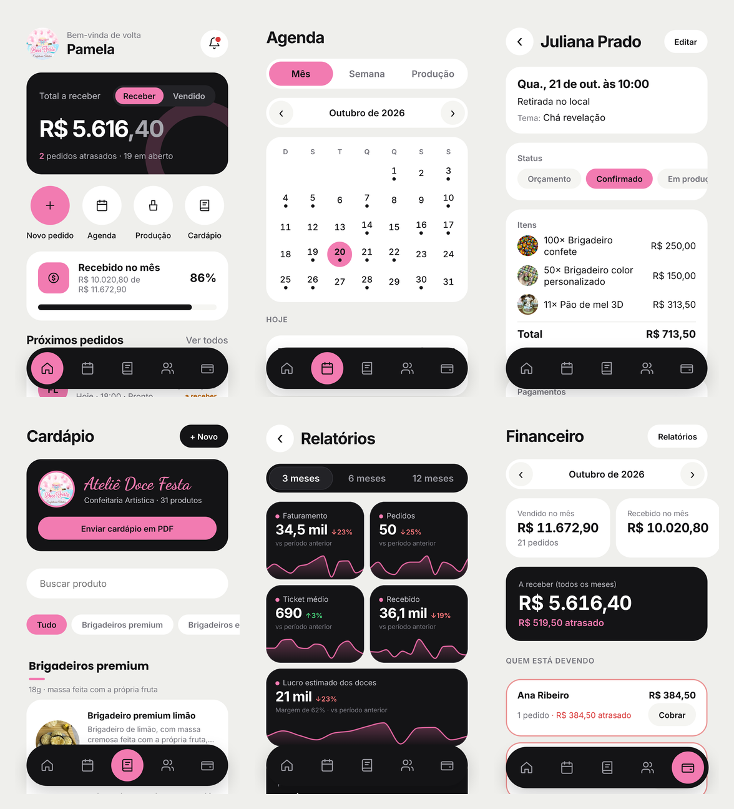
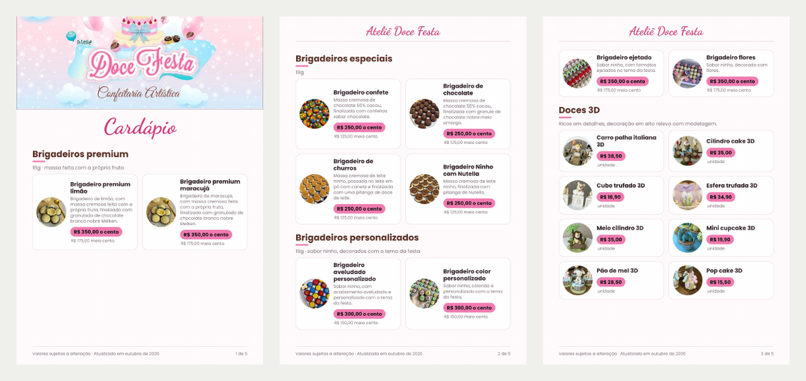

# Ateliê Doce Festa: gestão de pedidos para confeitaria


Aplicativo web instalável no celular (PWA), feito sob medida para uma **confeitaria real** de
São José dos Campos (SP). Ele substituiu o caderno onde a dona anotava tudo e hoje concentra
pedidos, clientes, agenda de entregas, pagamentos, cardápio, contratos e relatórios de
faturamento e lucro.

O app está **em produção** e é usado no dia a dia da loja, num iPhone.



<sub>Telas com dados fictícios.</sub>

---

## O problema

A dona da confeitaria controlava as encomendas num caderno. Isso trazia dificuldades:

- não ver com facilidade quais pedidos estavam marcados para cada dia;
- perder o controle de quem já tinha pagado o sinal e de quem estava devendo;
- não saber quanto faturava por mês nem quais doces davam mais lucro;
- montar à mão orçamentos, cardápios e contratos para enviar às clientes.

## A solução

Um app simples de usar no celular, com os dados na nuvem e acesso só da dona. As principais
decisões foram tomadas com ela, a partir do jeito que ela já trabalhava.

## Funcionalidades

**Pedidos e clientes**
- Pedido detalhado: cliente, data e horário, entrega ou retirada (com atalho para o Mapas),
  tema da festa, itens, taxa de entrega, observações e foto de referência.
- Fluxo de status: orçamento → confirmado → em produção → pronto → entregue.
- Itens escolhidos do cardápio com foto, com o preço preenchido automaticamente.
- Cadastro de clientes com histórico de pedidos e atalho para o WhatsApp.

**Agenda e produção**
- Calendário mensal e semanal com os pedidos de cada dia.
- Lista de produção: soma de tudo o que precisa ser feito no dia ou na semana.

**Financeiro**
- Pagamentos parciais (sinal e restante) por Pix, dinheiro ou cartão.
- Quanto foi vendido e recebido no mês, quanto falta receber e quem está em atraso.
- Botão "Cobrar", que abre o WhatsApp da cliente com a mensagem de cobrança pronta.

**Relatórios (estilo dashboard)**
- Faturamento, pedidos, ticket médio, recebido e **lucro estimado**, comparados com o período anterior.
- Gráfico de área empilhado por categoria, mapa de atividade das últimas 12 semanas e ranking
  dos produtos mais vendidos (por faturamento, quantidade ou lucro).

**Documentos para as clientes**
- **Cardápio em PDF**, gerado a partir dos produtos cadastrados e pronto para enviar no WhatsApp.
- **Orçamento e comprovante** em imagem, com o logo da loja.
- **Contratos** de encomenda de doces e de locação de bolo cenográfico, preenchidos com os
  dados do pedido e exportados em PDF.
- **Cópia de segurança** de todos os dados numa planilha Excel (.xlsx).



## Tecnologias

| Camada | Tecnologia |
| --- | --- |
| Interface | React 19, TypeScript, React Router, CSS próprio (sem framework de UI) |
| Build | Vite |
| Banco de dados | PostgreSQL no Supabase, com migrações SQL versionadas |
| Autenticação e arquivos | Supabase Auth (e-mail e senha) e Supabase Storage (bucket privado) |
| Hospedagem | Vercel, com deploy automático a partir do GitHub e prévia por branch |
| Documentos | jsPDF + Canvas API (PDF e imagens); gerador de .xlsx próprio |
| App no celular | PWA (manifest e ícones), instalado pela tela de início do iPhone |

## Decisões técnicas

- **Segurança no banco (Row Level Security).** Todas as tabelas têm políticas
  `user_id = auth.uid()`: mesmo com a chave pública do Supabase no front-end, cada registro só
  é lido ou alterado pela própria dona. As fotos ficam num bucket privado, com uma pasta por
  usuário, e são abertas por links temporários. O cadastro de novas contas é desligado.
- **Camada de dados com duas implementações.** As telas usam uma interface `Repo`
  ([`src/data/repo.ts`](src/data/repo.ts)) com uma versão para o Supabase e outra para o
  `localStorage`. Sem as variáveis de ambiente, o app abre em **modo demonstração**, o que
  facilita testar e apresentar o projeto sem acesso ao banco real.
- **Migrações idempotentes e tolerantes.** Os scripts em [`supabase/`](supabase) podem rodar
  mais de uma vez sem duplicar dados. O app também funciona antes de uma migração nova ser
  aplicada: se o banco ainda não tem uma coluna, a gravação é repetida sem ela.
- **Arquivos gerados no navegador.** PDF do cardápio e dos contratos, imagem do orçamento e
  planilha .xlsx são gerados no próprio celular, sem servidor. A planilha é montada à mão
  (XML do Office Open + zip), sem depender de biblioteca externa
  ([`src/lib/xlsx.ts`](src/lib/xlsx.ts)).
- **Lucro com histórico.** Ao salvar um pedido, o custo de cada item é guardado junto. Mudar o
  custo de um produto depois não altera o lucro de pedidos antigos.
- **Gráficos sem biblioteca.** Os gráficos dos relatórios são SVG feitos à mão, com curvas
  suaves e paleta de cores validada para contraste.

## Estrutura do projeto

```
src/
  pages/        telas (pedidos, agenda, cardápio, financeiro, relatórios, contratos…)
  data/         tipos e acesso a dados (Supabase ou modo demonstração)
  lib/          regras e geradores (lucro, produção, PDF, planilha, contratos, gráficos)
  components.tsx, icones.tsx, index.css
supabase/       esquema do banco e migrações SQL
public/         ícones, manifest do PWA e fotos do cardápio
```

## Como rodar

```bash
npm install
npm run dev
```

Sem configurar o Supabase, o app abre em **modo demonstração**: tudo funciona e os dados ficam
só no navegador.

<details>
<summary><strong>Configurar o banco (Supabase) e publicar (Vercel)</strong></summary>

1. Crie um projeto em [supabase.com](https://supabase.com).
2. Em **SQL Editor**, rode na ordem [`schema.sql`](supabase/schema.sql),
   [`002_pagamentos.sql`](supabase/002_pagamentos.sql), [`003_produtos.sql`](supabase/003_produtos.sql),
   [`004_cardapio_inicial.sql`](supabase/004_cardapio_inicial.sql), [`005_contrato.sql`](supabase/005_contrato.sql),
   [`006_cardapio_organizado.sql`](supabase/006_cardapio_organizado.sql) e [`007_custo.sql`](supabase/007_custo.sql).
3. Em **Authentication → Sign In / Providers**, desligue **Allow new users to sign up**.
4. Em **Authentication → Users → Add user**, crie o usuário da dona.
5. Copie `.env.example` para `.env.local` e preencha `VITE_SUPABASE_URL` e `VITE_SUPABASE_ANON_KEY`
   (em **Project Settings → API**).
6. Na [Vercel](https://vercel.com), importe o repositório e adicione as mesmas duas variáveis.
7. No iPhone, abra o endereço no Safari → **Compartilhar → Adicionar à Tela de Início**.

Os dados da loja usados nos contratos (cidade, valores, pedido mínimo) ficam em
[`src/marca.ts`](src/marca.ts).

</details>

## Como foi desenvolvido

O projeto partiu de conversas com a dona da loja para entender a rotina dela. Daí saíram o
escopo e as prioridades, registrados em [PLANO.md](PLANO.md). O desenvolvimento foi feito em
etapas curtas: cada melhoria ia primeiro para uma prévia na Vercel, era validada com a usuária
e só então publicada.

Usei IA (Claude Code) como ferramenta de desenvolvimento. Fiquei responsável pelo levantamento
de requisitos, pelas decisões de produto, pela configuração da infraestrutura (Supabase,
Vercel, GitHub), pelos testes e pela validação de cada entrega com a cliente.

---

Autor: [@lucashsjc](https://github.com/lucashsjc)
